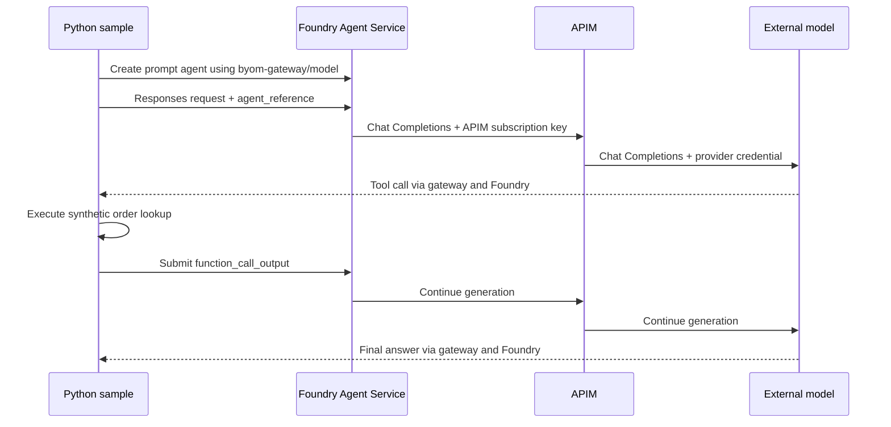

# Bring Your Own Model to Foundry Agent Service

An end-to-end workshop for connecting an **external model** through Azure API
Management (APIM), creating an Agents v2 prompt agent, and testing text and
client-side function calling. Based on the [Microsoft Learn BYOM guide](https://learn.microsoft.com/azure/foundry/agents/how-to/ai-gateway?tabs=api-management&pivots=foundry-portal).

This complements the existing [agent fundamentals notebook](../azure-ai-agents/1-basics.ipynb):
it uses the same `AIProjectClient`, `DefaultAzureCredential`, and Responses API,
but replaces an Azure-hosted deployment name with **`<connection-name>/<model-name>`**.
It does not train, upload, or redeploy model weights, or deploy a hosted agent container.
The upstream model remains with its provider. No existing notebooks or root dependencies
need to change.



## Files

| File | Purpose |
| --- | --- |
| [main.py](main.py) | Configuration, gateway probe, connection lookup, agent run, cleanup |
| [Root .env.example](../.env.example) | Shared configuration template for every workshop sample |
| [requirements.txt](requirements.txt) | Isolated, pinned sample dependencies |
| [apim-policy.xml](apim-policy.xml) | Dedicated demo API policy for a bearer-authenticated OpenAI-compatible backend |
| [test_byom.py](test_byom.py) | Offline behavior and SDK wire-contract tests |
| [runtime-validation-report.md](runtime-validation-report.md) | What was actually verified and the remaining live-test boundary |

## 1. Prerequisites

- Python 3.10+ and Azure CLI 2.67+.
- An existing Microsoft Foundry **project**, with Agents v2 available. Use a project
  endpoint ending in `/api/projects/<project-name>`, not an account endpoint.
  If needed, [create a project](https://learn.microsoft.com/azure/foundry/how-to/create-projects).
- **Foundry User** or higher on the project (previously Azure AI User), and permission
  to create its connections. Contributor on the resource group is required when
  deploying connections with ARM/Bicep. APIM configuration requires the applicable
  gateway permissions as well.
- An existing APIM instance and an external model endpoint supporting **OpenAI Chat
  Completions**, including function/tool calling for the full test. You must hold the
  provider account, license, quota, and API key. For example, an OpenAI API model
  behind APIM is external BYOM; an Azure-sold Foundry model is not BYOM under the
  Learn article's definition.
- The APIM gateway must be reachable from the managed Agent Service inference
  plane. A successful request from your laptop alone does not establish this.

This walkthrough reuses infrastructure; it does not provision billable services or
select a subscription/project automatically. Foundry, APIM, and model inference
can incur charges. Use synthetic data only.

## 2. Prepare APIM and the upstream model

### Reuse the gateway from the screenshots

The supplied gateway and project have these values, confirmed with read-only Azure
management queries:

| Setting | Value |
| --- | --- |
| Azure subscription ID | `93c5449c-bbb2-4249-9461-ddf749e03430` |
| Resource group | `demoaifoundry` |
| Region | `westus` |
| APIM resource | `apim-aigw-ti5dnrk6tsgjw` |
| Gateway endpoint | `https://apim-aigw-ti5dnrk6tsgjw.azure-api.net` |
| Foundry resource / project | `demopocaifoundry` / `demoproject` |
| APIM API | `Azure OpenAI (via AI Gateway)` (API ID `azure-openai-api`) |
| API base URL | `https://apim-aigw-ti5dnrk6tsgjw.azure-api.net/openai` |
| Existing project connection | `Azure-OpenAI-(via-AI-Gateway)` |
| Available chat deployment for this walkthrough | `gpt-4.1` |

This API exposes **`/deployments/{deployment-id}/chat/completions?api-version={api-version}`**,
not `/chat/completions` directly under `/openai`. Its backend is the existing Azure
AI resource, not an external provider. Use the existing-connection instructions in
step 3; do not replace this API's policy with [apim-policy.xml](apim-policy.xml).
The screenshot's **Enabled** gateway status does not mean a connected model has
been configured.

This is Azure-hosted model routing through APIM, not external BYOM under the Learn
guide's definition. The Python Foundry agent flow can use either connection setup.

### Optional: prepare a separate external-model API

Use this path only for the external-provider workshop. Keep it separate from the
existing `azure-openai-api`. In the Azure portal:

1. Open APIM > **Named values**. Create `byom-upstream-base-url`, such as
   `https://api.openai.com/v1`, without a trailing inference operation. Create
   `byom-upstream-api-key` as a **secret**, preferably a Key Vault reference.
2. Under **APIs**, add a dedicated **HTTP / blank API** with API URL suffix
   `openai/v1` and web service URL equal to the upstream base URL.
3. Add an operation: method **POST**, URL **`/chat/completions`**. Keep
   **Subscription required** enabled. Use an API-scoped subscription, an all-APIs
   subscription, or a product subscription whose product contains this API.
4. Apply [apim-policy.xml](apim-policy.xml) to this **dedicated API**, preserving any
   organization-required authentication and safety policies. It replaces the inbound
   authorization with the provider key, removes gateway credentials before forwarding,
   and removes Azure-style API-version queries for this OpenAI v1 backend.
5. Confirm the exposed URL is
   `https://<apim-name>.azure-api.net/openai/v1/chat/completions`.

The policy targets a bearer-authenticated OpenAI-compatible provider. A provider
using `api-key`, Anthropic Messages, or a different contract needs a matching policy
and route; it is not covered by this sample. There is no `/models` operation here:
the next step uses a **static model list**.

There are two different secrets:

| Secret | Where it belongs |
| --- | --- |
| Provider API key | APIM secret named value / Key Vault, not Foundry or the sample |
| APIM subscription key | Foundry model connection; optionally local `.env` for the direct probe |

## 3. Create the connected model in Foundry

### Configure the existing Azure OpenAI connection

In the New Foundry UI shown in the screenshots, open project **`demoproject`**.
Open its **Connections** from **Manage > Project details**, or use
**Models > Connections**, and edit **`Azure-OpenAI-(via-AI-Gateway)`** if it is
already saved. Do not create a duplicate just because the agent's **Configure
model** list is empty.

Read-only inspection found this connection with an empty model list (`models=[]`),
`deploymentInPath=false`, and no inference API version. These settings explain the
missing connected model and do not match the existing API's deployment-style route.

In the **Connect a model through a Gateway** wizard, use:

| Wizard setting | Value / action |
| --- | --- |
| Connection type | **Azure API Management (v1 & v2 tiers)** |
| Gateway / API | `apim-aigw-ti5dnrk6tsgjw` / `Azure OpenAI (via AI Gateway)` |
| Base URL | `https://apim-aigw-ti5dnrk6tsgjw.azure-api.net/openai` |
| **Pass the deployment name in the URL path** | **Enable** (also called **Include deployment name in URL path**) |
| **Pass an API version in the URL** | **Enable**; enter `2024-10-21` in the API-version field |
| Upstream Responses API, if shown | **Disabled**; use **Chat Completions** |
| Authentication | **API key**, using an APIM subscription key valid for this API |
| API key header name / value format | `Ocp-Apim-Subscription-Key` / `{api_key}` |
| Scope | **Project**, `demoproject` |

On **Model configuration**, you are adding models to this connection, **not
selecting another connection**:

1. Select **+ Add model** (use the static/manual model option if discovery is empty).
2. Set **Name** to **`gpt-4.1`**, the verified Azure deployment name.
3. Set **Display name** to **`gpt-4.1 via APIM`**.
4. Leave **Version** empty. This field can append a suffix to the model name; it is
   not the inference API version.
5. Save the model, then save/add the connection. This API has no GET `/deployments`
   discovery operation, so do not rely on automatic model discovery.

Before saving, confirm the generated request URL is:

```text
https://apim-aigw-ti5dnrk6tsgjw.azure-api.net/openai/deployments/gpt-4.1/chat/completions?api-version=2024-10-21
```

Return to the agent's **Configure model** picker and refresh/reopen it. Select the
connected **`gpt-4.1`** deployment associated with this gateway connection, rather
than the direct Azure-hosted deployment with the same model name. Its Python model
reference is **`Azure-OpenAI-(via-AI-Gateway)/gpt-4.1`**.

### Connect the separate external-model API

Use this alternative only if you prepared the optional `/openai/v1` API in step 2.
In [Microsoft Foundry](https://ai.azure.com), open the intended project:

1. **Connections > Add connection > Model > Azure API Management/AI Gateway**.
2. Select your APIM resource and name the connection **`byom-gateway`**.
3. Enter base URL **`https://<apim-name>.azure-api.net/openai/v1`**.
   Do not include `/chat/completions`, `/responses`, or a query string.
4. Leave **Use the Responses API for upstream requests** disabled. The sample uses
   Chat Completions **between Foundry and the gateway**, even though the Python app
   invokes Foundry through the Responses API.
5. Select **API key** authentication. Enter the **APIM subscription key**, header name
   **`Ocp-Apim-Subscription-Key`**, and header value format **`{api_key}`**.
6. On **Model configuration**, select **+ Add model**. Enter the exact upstream model
   ID in **Name** and a display name. Leave **Version** empty for this walkthrough.
   For example, use `gpt-4.1-mini` only if that model is available in your external
   provider account. A static list avoids APIM's default `/deployments` discovery.
7. Under **Advanced**, disable **Include deployment name in URL path**. Do not set an
   API version for this OpenAI v1 route. Optionally add static header
   `X-BYOM-Source: foundry-agent-service` to distinguish Foundry traffic in gateway logs.
8. Use **project scope**. Confirm the generated URL ends in **`/chat/completions`**,
   then add the connection. Confirm its status and model in the portal.

The model reference is now **`byom-gateway/<upstream-model-name>`**. Creating a
connection does not relocate the upstream model. For CLI-based connection creation,
use the [official connection templates](https://github.com/microsoft-foundry/foundry-samples/tree/main/infrastructure/infrastructure-setup-bicep/01-connections)
instead of guessing connection metadata.

For a non-APIM gateway, select the supported endpoint source and use a `ModelGateway`
connection. The Python agent flow is the same. To reuse the optional probe, that
gateway must expose this sample's `/openai/v1/chat/completions` route; set its expected
key header and format, such as `Authorization` and `Bearer {api_key}`.

## 4. Configure Python

Run from the repository root in PowerShell:

```powershell
python -m venv byom\.venv
.\byom\.venv\Scripts\Activate.ps1
python -m pip install -r byom\requirements.txt
az login
az account set --subscription "93c5449c-bbb2-4249-9461-ddf749e03430"
```

Use the repository's shared [root .env](../.env), based on
[.env.example](../.env.example). Its project endpoint is shared with the notebooks
and hosted agent. Add only the connected-model reference for this sample:

For the existing gateway and connection from the screenshots:

```dotenv
FOUNDRY_MODEL_DEPLOYMENT_NAME=Azure-OpenAI-(via-AI-Gateway)/gpt-4.1
```

For the separate external-model connection instead:

```dotenv
FOUNDRY_MODEL_DEPLOYMENT_NAME=byom-gateway/<upstream-model-name>
```

The shared project settings should identify resource group `demoaifoundry`,
Foundry resource `demopocaifoundry`, and project `demoproject`. Keep the Foundry
**project endpoint** in `FOUNDRY_PROJECT_ENDPOINT`; do not replace it with the APIM
base URL.

Only `--check-gateway` needs `BYOM_GATEWAY_BASE_URL` and `BYOM_GATEWAY_API_KEY`.
The Foundry flow reads gateway credentials from the Foundry connection, not your
local environment. `.env` is ignored by Git; do not put real keys in examples,
command arguments, notebooks, or test reports.

The default env file is the repository-root `.env`, independent of the working
directory; no BYOM-specific copy is needed. Use `--env-file <path>` only for an
intentional override. The `AI_FOUNDRY_PROJECT_ENDPOINT` name is also supported.
The BYOM model variable is
deliberately separate from the workshop's `AZURE_AI_MODEL_DEPLOYMENT_NAME`.
Already-set process variables take precedence over values in the env file.

## 5. Test the flow

```powershell
# No network or credentials required for the offline regression suite.
python -m unittest discover -s byom -p test_byom.py -v

# Validates your configuration without authenticating or calling a service.
python byom/main.py --check-config

# Read-only existence/type check; does not validate saved models or routing.
python byom/main.py --check-connection

# Complete Foundry -> gateway -> model + function round trip.
python byom/main.py

# Also check laptop -> gateway -> model first (requires the optional gateway key).
python byom/main.py --check-gateway
```

For the existing Azure OpenAI deployment-style route, **omit `--check-gateway`**.
That optional direct probe only supports the separate `/openai/v1/chat/completions`
API; it does not support deployment paths or an `api-version` query parameter.
The normal Foundry run uses the routing saved in the connection instead.

The full run creates a uniquely named prompt-agent version, reads back its connected
model, creates a conversation, and checks a fresh text marker. It then requires an
actual `get_order_status` function call for synthetic order `ORDER-1001`. The local
tool returns `shipped` and a random verification value that was **not in the prompt**.
The final model answer must include both. The conversation and agent version are
deleted in a `finally`-equivalent cleanup stack, including when a request fails.
Cleanup failures make the run fail rather than reporting false success.

An exit code of **0** means all selected checks completed. A missing connection,
unsupported tool call, incomplete answer, or failed cleanup returns **1**. Logs show
agent/conversation/response IDs but not keys or model response bodies.

Use `--skip-tools` for a text-only model; that is **not** a passed tool-calling test.
Use `--keep` only for investigation in the portal: it retains resources **even on
failure** and prints their IDs. Reruns use a new temporary agent name.

## 6. Confirm routing and clean up

In APIM analytics or gateway diagnostics, verify POST requests to the demo operation
at the test time. If configured, inspect `X-BYOM-Source` on Foundry-originated requests.
Confirm the backend target is your intended **external model** and requests succeeded.
Never log authorization/subscription headers or sensitive prompt/response bodies.
See the Learn guide for Application Insights and `ApiManagementGatewayLogs` queries.
An offline mock test, or a direct laptop-to-gateway probe, is not evidence that the
managed Foundry service reached the gateway.

Normal runs delete their conversation and agent version; the configured connection,
APIM API/subscription, provider account, and any shared infrastructure remain.
For a `--keep` run, delete the printed conversation and version after inspection:

```python
from azure.ai.projects import AIProjectClient
from azure.identity import DefaultAzureCredential

with DefaultAzureCredential() as credential:
    with AIProjectClient(
        endpoint="<project-endpoint>", credential=credential
    ) as project:
        with project.get_openai_client() as client:
            client.conversations.delete(conversation_id="<printed-conversation-id>")
        project.agents.delete_version(
            agent_name="<printed-agent-name>", agent_version="<printed-version>"
        )
```

Remove the dedicated demo connection and APIM API/subscription in their portals only
when no other application uses them. Do not delete shared resources.

## Troubleshooting and boundaries

| Symptom | Check |
| --- | --- |
| Local configuration fails | Replace placeholders; use a project endpoint and `connection/model`, not a bare model name. |
| No connection/model in the agent's Configure model picker | A gateway marked Enabled is not sufficient. Edit `Azure-OpenAI-(via-AI-Gateway)`, add and save a static `gpt-4.1` model, save the connection in `demoproject`, and refresh the picker. |
| Wizard previews `/openai/chat/completions` for the supplied gateway | Enable deployment name in the URL path and API version; use `gpt-4.1` and `2024-10-21`. The existing API requires `/openai/deployments/gpt-4.1/chat/completions?api-version=2024-10-21`. |
| Foundry 401/403 | Run `az login` in the intended tenant; verify project RBAC and connection permissions. |
| Gateway 401/403 | Use the APIM subscription key and the matching header; verify the subscription covers this API. Check provider credentials separately. |
| Model not found / 404 | Verify connection scope, the exact static model/deployment name, upstream availability, and the route for the selected setup: deployment-style `/openai/deployments/...` or the separate `/openai/v1/chat/completions` API. |
| Gateway reachable locally but Foundry times out | Check reachability from the managed inference plane, firewall rules, DNS, and the Learn private-network guidance. |
| No tool call / provider rejects tool schema | Use a function-capable model and compatible gateway, or explicitly run the reduced `--skip-tools` test. |
| Read-back model differs | Verify the saved agent version and selected connection; the sample stops rather than invoking a different model. |
| No configuration in VS Code | Foundry Toolkit project-selection tools are optional; this sample uses explicit environment settings and never silently picks a project. |

BYOM supports Agents v2 prompt agents, not the Microsoft Copilot harness. Per the
linked guide, connected models do not support Foundry IQ, agent optimization,
agent memory, synthetic data generation, Foundry guardrails, real-time audio, or
vision decision models. Upstream Responses routing is a separate, availability-dependent
configuration and is intentionally not used here.

For private gateways, a capability host or placement in a delegated agent subnet
alone does not make the gateway reachable from managed connected-model inference.
Follow the current Learn networking guidance for a validated topology.

You are responsible for provider licensing, data residency/retention, and responsible
AI mitigations, including suitable model/gateway safety controls. API keys in this
walkthrough are for a focused demo; review the Learn guide's managed-identity APIM
authentication option before production use.